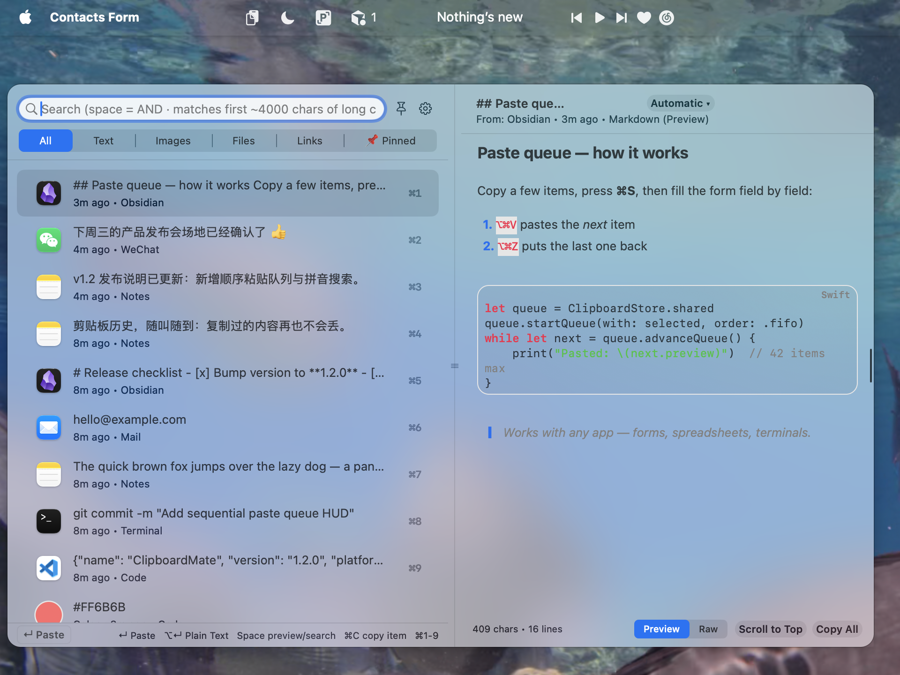
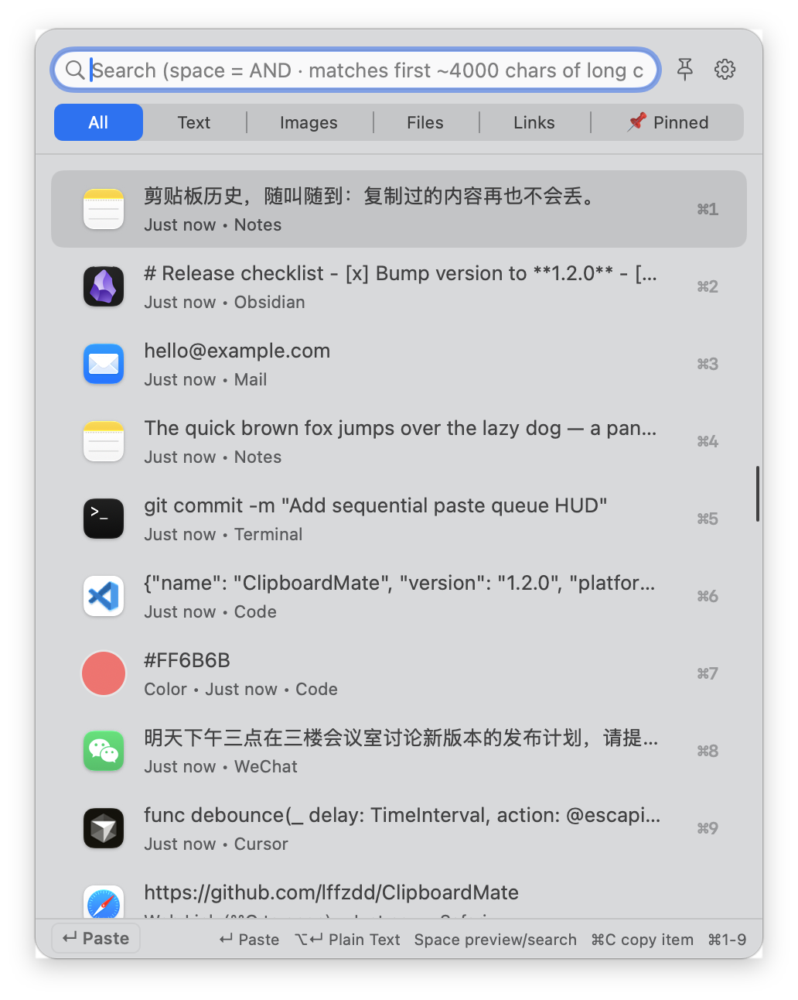
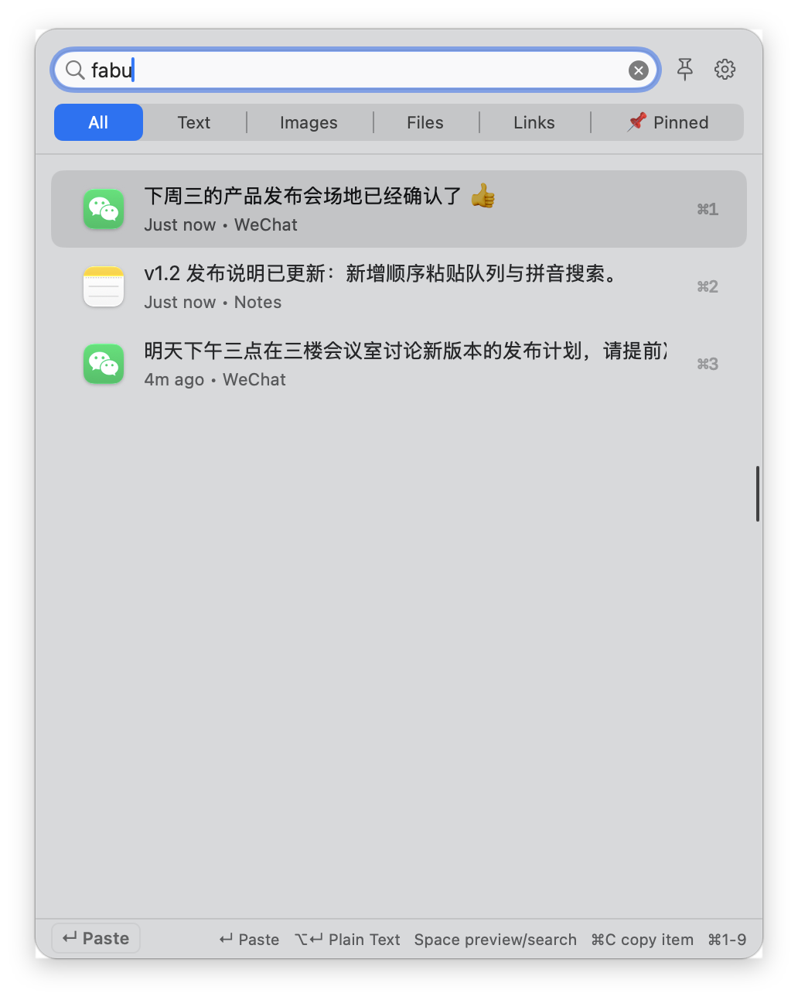
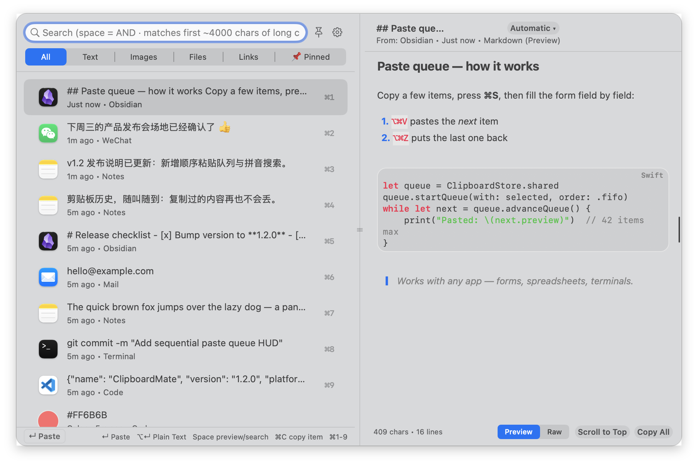
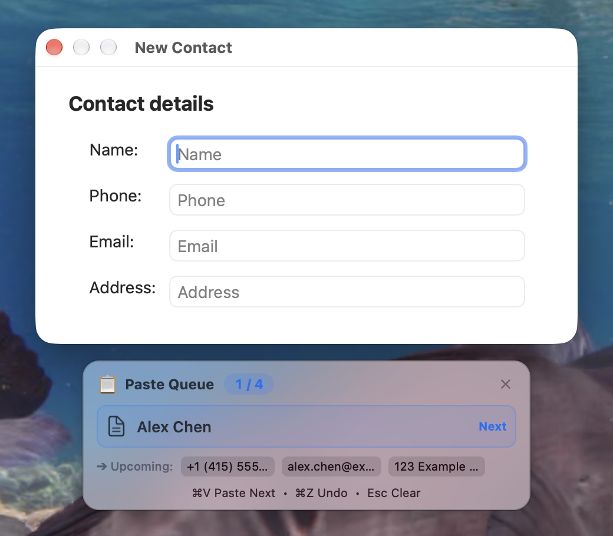
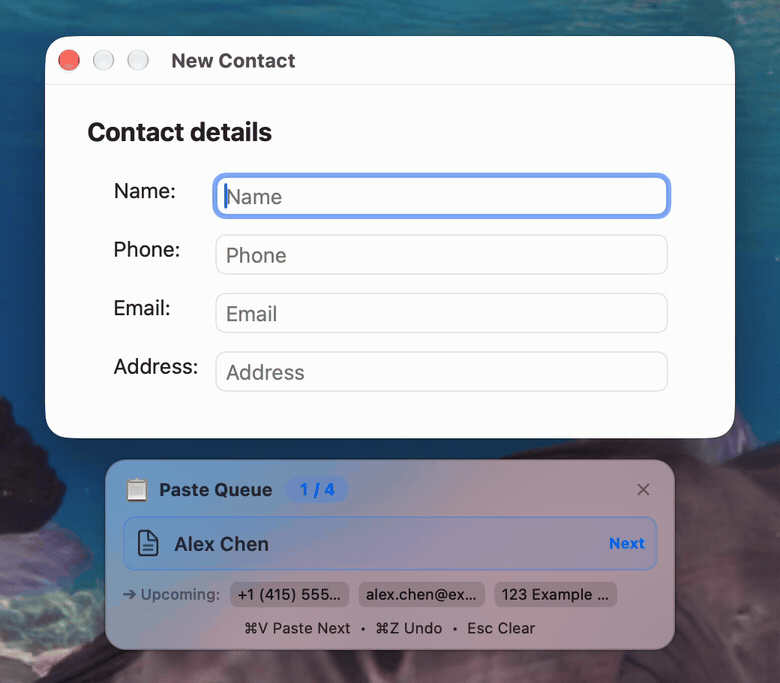
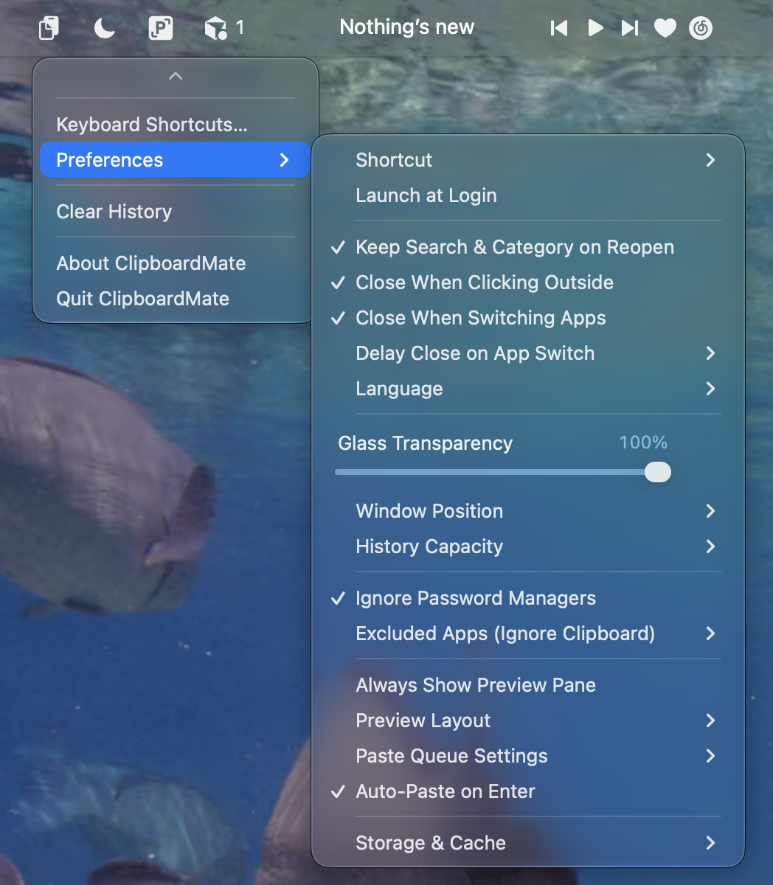

# ClipboardMate

**English** | [中文](README.zh-CN.md)

<!--
  IMAGE SLOTS — drop the Mac captures here, same filename, then both READMEs pick them up.
  docs/hero.png              hero shot: menu-bar icon + history panel on a real desktop
  docs/history-panel.png     history panel, list + bottom hint visible
  docs/search.png            search, ideally a pinyin query matching Chinese text
  docs/markdown-preview.png  side preview with Markdown and a highlighted code block
  docs/paste-queue-hud.png   the floating paste-queue capsule
  docs/preferences.png       the Preferences menu (menu-bar right-click or the gear)
  docs/demo.gif              sequential paste: queue advances as each field is filled
-->

<p align="center">
  
</p>

<p align="center">
  <strong>Copy a name, a phone number, an address. Paste them into the form, one field at a time.</strong>
</p>

<p align="center">
  <a href="https://github.com/lffzdd/ClipboardMate/releases/latest"></a>
  <a href="https://github.com/lffzdd/ClipboardMate/releases/latest"></a>
  <a href="LICENSE"></a>
  <a href="https://github.com/lffzdd/ClipboardMate/releases/latest"></a>
</p>

<p align="center">
  <a href="https://github.com/lffzdd/ClipboardMate/releases/latest"></a>
</p>

<p align="center">
  <a href="https://github.com/lffzdd/ClipboardMate/releases/latest">Get the latest ClipboardMate.dmg</a>
  · menu-bar app · pure Swift · no account
</p>

ClipboardMate sits in the menu bar and keeps what you copy: plain text, HTML and RTF, images, and Finder files. Press <kbd>⌘⇧V</kbd> in any app, press Return, and it pastes back into the window you just left.

The part you will actually feel is the paste queue. Copy the fields of a form in order, press <kbd>⌘S</kbd>, and a small frosted capsule appears at the bottom of the screen. It shows the next item and the ones waiting behind it, and it does not take keyboard focus. Each <kbd>⌘V</kbd> fills the next field.

## Why ClipboardMate

| Fill the form in order | Stay on the keyboard | Keep it on this Mac |
| --- | --- | --- |
| First copied, first pasted. The capsule shows what lands next, and <kbd>⌘Z</kbd> puts a mis-paste back at the front. | The first row is already selected. Return pastes it. <kbd>⌘1</kbd>–<kbd>⌘9</kbd> jump straight to a row. | Pure Swift and AppKit, no third-party libraries. History stays in Application Support. Copies from password managers are ignored. |

## A look inside

### History, one keystroke away

<!-- image-slot: docs/history-panel.png — history panel -->

<p align="center">
  
</p>

Click the menu-bar icon, or press <kbd>⌘⇧V</kbd>. Text, images, files, links, and colors land in one list, newest first, with <kbd>⌘1</kbd>–<kbd>⌘9</kbd> on the first nine rows. Filter with **All · Text · Images · Files · Links · Pinned**. Pin the things you reuse. Give a row an alias with <kbd>⌘R</kbd> and search will find that name.

### Search, including pinyin

<!-- image-slot: docs/search.png — search, ideally pinyin -->

<p align="center">
  
</p>

Type in the search field. Separate words with spaces and every word must match. Chinese text matches the characters, the full pinyin, and the initials — `zs` finds 张三. Long clips are matched within the first few thousand characters. <kbd>Esc</kbd> clears the query, then closes the panel.

### Markdown and code, already rendered

<!-- image-slot: docs/markdown-preview.png — markdown and code preview -->

<p align="center">
  
</p>

<kbd>Space</kbd> opens the side preview when the search field is empty. Markdown can show as a preview or as the original text. Fenced code is highlighted, and a click copies that block. Images carry recognized text (Vision OCR); <kbd>⌥↵</kbd> pastes that text. Links open in the browser with <kbd>⌘O</kbd>. Files reveal in Finder. Hex colors get a swatch, plus copy as HEX, RGB, or HSL. Double-click an image for Quick Look.

### The paste-queue capsule

<!-- image-slot: docs/paste-queue-hud.png — floating paste-queue HUD -->

<p align="center">
  
</p>

<!-- image-slot: docs/demo.gif — sequential paste demo -->

<p align="center">
  
</p>

Four moves:

1. Copy the name, then the phone, then the address.
2. Press <kbd>⌘S</kbd>. The panel closes. The capsule shows the next item, up to three waiting behind it, and how many are left. <kbd>⇧⌘S</kbd> reverses the order.
3. Click the first field. <kbd>⌘V</kbd> pastes and the capsule advances. (The direct <kbd>⌘V</kbd> / <kbd>⌘Z</kbd> behavior is on by default while a queue is active. <kbd>⌥⌘V</kbd> and <kbd>⌥⌘Z</kbd> always work.)
4. Pasted into the wrong field? <kbd>⌘Z</kbd> puts that item back at the front. <kbd>Esc</kbd>, or the ✕ on the capsule, clears the queue.

**Collect mode** (<kbd>⌥⌘C</kbd>) is the same queue in reverse: each new copy joins automatically, so you can gather fields without opening the panel, then paste them in the form.

Select several rows and Return joins them with newlines and pastes once. <kbd>⇧↵</kbd> joins them with commas. The context menu also offers spaces, no separator, or plain text.

### Preferences

<!-- image-slot: docs/preferences.png — Preferences menu -->

<p align="center">
  
</p>

Right-click the menu-bar icon, or click the gear in the panel.

| | |
| --- | --- |
| Shortcut | <kbd>⌘⇧V</kbd>, <kbd>⌥Space</kbd>, <kbd>⌥V</kbd>, or <kbd>⌃⌥V</kbd>. <kbd>⌘1</kbd>–<kbd>⌘9</kbd> can be turned off. |
| Launch at login | On from the menu. Uses the system login item, and falls back to a login agent if macOS refuses. |
| Panel | Keep the last search and category. Close when clicking outside, or when switching apps (immediately, or after a short delay). The pin beside search keeps this visit open. |
| Look | Glass transparency. Open at the center of the screen, or near the pointer. Preview always on, compact, automatic, or wide. |
| History | 50, 100, 200, or 500 items. The default is 200. Pinned rows are kept when you clear history. |
| Language | Follow the system, Simplified Chinese, or English. |
| Paste queue | FIFO, LIFO, or the list order. Show or hide the capsule. Let <kbd>⌘V</kbd> / <kbd>⌘Z</kbd> drive the queue. |
| Privacy | Ignore copies from password managers (1Password, Bitwarden, LastPass, KeePassXC, Apple Passwords, and others) and concealed clipboard types. Exclude any other app by name. |
| Storage | Image cache size, clean images older than 30 days, drop history rows whose files have gone missing. |

Delete a row and the panel tells you. <kbd>⌘Z</kbd> puts it back. The same undo covers **Clear History**.

## Shortcuts

| | |
| --- | --- |
| <kbd>⌘⇧V</kbd> | Show or hide history. Changeable in Preferences. |
| <kbd>↵</kbd> | Paste the selection. Several rows join with newlines. HTML and RTF are kept when the clip had them. |
| <kbd>⇧↵</kbd> | Join the selection with commas and paste. |
| <kbd>⌥↵</kbd> | Paste as plain text. On an image, paste the recognized text. |
| <kbd>⌘C</kbd> | Copy to the clipboard only. |
| <kbd>⌘1</kbd>–<kbd>⌘9</kbd> | Paste that row. |
| <kbd>Space</kbd> | Toggle the preview when search is empty. Otherwise, type a space. |
| <kbd>⌘O</kbd> | Open a link, or reveal a file in Finder. |
| <kbd>⌘P</kbd> | Pin or unpin. |
| <kbd>⌘R</kbd> | Rename / set an alias. |
| <kbd>⌘S</kbd> / <kbd>⇧⌘S</kbd> | Start the paste queue, first-copied or last-copied first. |
| <kbd>⌘A</kbd> | Select every row in the current list. |
| <kbd>⌘Z</kbd> | Undo the last delete or clear, while the panel is open. |
| <kbd>Delete</kbd> | Delete the selection when search is empty. |
| <kbd>Tab</kbd> / <kbd>⇧Tab</kbd> | Cycle the category tabs. |
| <kbd>↑</kbd> <kbd>↓</kbd> | Move the selection, including from the search field. |
| <kbd>⌥⌘V</kbd> | Paste the next queued item. |
| <kbd>⌥⌘Z</kbd> | Put the last pasted item back at the front of the queue. |
| <kbd>⌥⌘C</kbd> | Turn collect mode on or off. |
| <kbd>Esc</kbd> | Clear search, close the panel, or clear the queue. |

The full list is also under **Keyboard Shortcuts…** in the menu bar.

A few extras live on the row’s context menu: edit the text, format or minify JSON, change case (`camelCase`, `snake_case`, `kebab-case`, upper, lower), URL-encode, and Base64-encode.

## Install

1. Download [ClipboardMate.dmg](https://github.com/lffzdd/ClipboardMate/releases/latest).
2. Open it and drag **ClipboardMate** into **Applications**.
3. The disk image is ad-hoc signed and not notarized. The first launch, right-click the app and choose **Open**. macOS will say the developer cannot be verified — confirm **Open**. A clipboard icon then appears in the menu bar.
4. Click the icon for history. Right-click it, or use the gear in the panel, for preferences. Or press <kbd>⌘⇧V</kbd> anywhere, choose a row, and press Return.

### Let Return paste into the previous app

Browsing history needs no permission. Simulating <kbd>⌘V</kbd> needs Accessibility, once:

1. The first time you paste with Return, macOS asks.
2. Open **System Settings → Privacy & Security → Accessibility** and turn **ClipboardMate** on.
3. Return then pastes straight back. Without permission, or with **Auto-Paste on Enter** off, the app only writes the clipboard and you press <kbd>⌘V</kbd> yourself.

Rebuilding with `./build.sh` signs the app ad hoc again, and macOS may drop the Accessibility grant. If Return stops pasting, turn ClipboardMate on again under Accessibility. The menu bar shows **Grant Accessibility to Auto-Paste…** when that happens. After an update, grant it once more.

## Build from source

macOS 13 or later.

```bash
git clone https://github.com/lffzdd/ClipboardMate.git
cd ClipboardMate
./build.sh          # build and install to /Applications/ClipboardMate.app
./package_dmg.sh    # or write build/ClipboardMate.dmg
```

## Layout

| | |
| --- | --- |
| `main.swift` | Entry point |
| `AppDelegate.swift` | Menu bar, preferences, app lifecycle |
| `ClipboardStore.swift` | Clipboard watching, storage, paste simulation, the queue |
| `PanelController.swift` | History panel |
| `QueueHUDWindowController.swift` | Floating paste-queue capsule |
| `HotKey.swift` | Global shortcuts through Carbon |
| `ClipItem.swift` | Item model |
| `MarkdownRenderer.swift` / `SyntaxHighlighter.swift` | Markdown preview and code color |
| `PinyinHelper.swift` | Pinyin and initial-letter search |
| `TextTransformer.swift` | Case, JSON, URL, and Base64 transforms |
| `QuickLookManager.swift` | Quick Look |
| `Localization.swift` | English and Chinese strings |

History is stored in `~/Library/Application Support/ClipboardMate/`. Each save keeps the previous file as a backup.

## License

[MIT](LICENSE) © 2026 lffzdd
